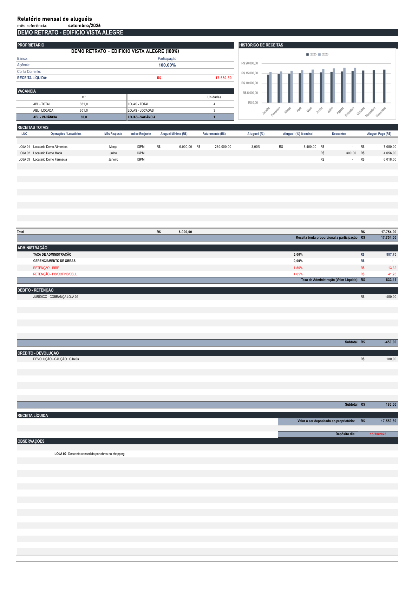
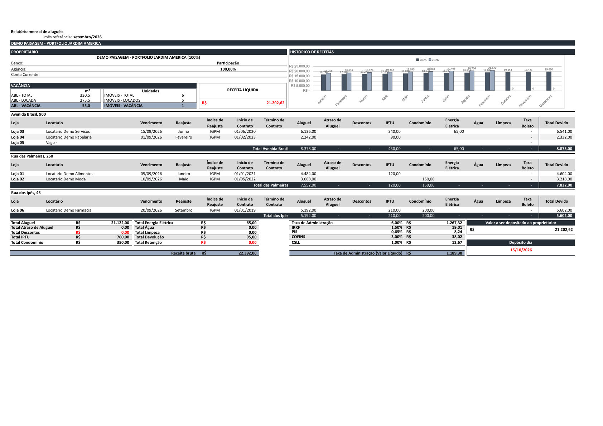
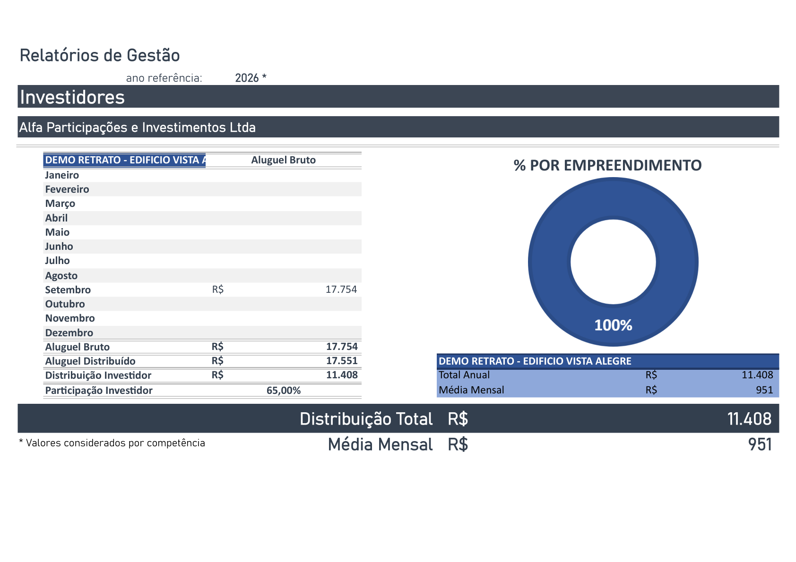

# Gestão Mais

Sistema de gestão financeira para empresas de administração de imóveis
comerciais/residenciais — aluguéis, rateio entre sócios, impostos,
prestação de contas e relatórios de distribuição. Construído para
substituir um controle feito inteiramente em planilhas Excel por uma
aplicação web com banco de dados relacional, API própria e frontend
próprio.

> Este repositório é um **case study** — não contém o código-fonte do
> sistema (que é privado, construído sob contrato para um cliente real).
> O objetivo aqui é mostrar o problema resolvido, as decisões técnicas e
> alguns resultados visuais. Todos os nomes, valores e empreendimentos
> nas capturas de tela abaixo são **dados sintéticos de demonstração**
> (nunca dado real de cliente).

## O problema

A empresa administrava dezenas de empreendimentos (shoppings, galerias,
prédios comerciais) e fazia **todo o fechamento financeiro mensal em
planilhas Excel**: cálculo de aluguel recebido por loja, rateio entre
vários sócios conforme o percentual de participação de cada um, retenção
de impostos, taxa de administração, e a montagem manual de um relatório em
PDF para cada sócio, todo mês, para cada empreendimento. O processo era
lento, propenso a erro de fórmula, e não deixava histórico consultável —
só a última versão da planilha.

## O que o sistema faz

- **Cadastro completo**: empreendimentos, unidades locáveis (LUCs),
  locatários, sócios (pessoa física ou jurídica, com dados bancários e
  signatário), contas correntes.
- **Lançamento financeiro** (aluguel, descontos, IPTU, condomínio, taxas
  etc.) com importador de planilhas legadas (mapeamento de coluna
  configurável, detecção de inconsistência).
- **Distribuição mensal**: calcula quanto cada sócio recebe, já descontando
  taxa de administração e impostos configuráveis (com vigência própria —
  preparado para a reforma tributária, trocando os nomes dos impostos sem
  mudar o cálculo).
- **Relatório Mensal de prestação de contas** (PDF fiel ao layout real
  usado pela empresa, dois modelos: genérico e por unidade/subunidade),
  com histórico de receitas, bloco de vacância e faturamento variável de
  referência.
- **Relatório de Gestão**: consolidação **anual por sócio**, cobrindo
  todos os empreendimentos em que ele participa — total distribuído,
  participação e peso de cada empreendimento (gráfico de rosca), com
  layout que se auto-ajusta conforme a quantidade de empreendimentos do
  sócio.
- **DIMOB**: agregação anual locador × locatário para a declaração anual
  da Receita Federal, com detecção de cadastro incompleto (CPF/CNPJ
  faltante).
- **Calendário de distribuição**: data do depósito ao sócio, com sugestão
  automática (10º dia útil) e ajuste manual para feriados locais que o
  algoritmo não conhece.
- **Controle de acesso por papel** (administrador/gestor/auditor/
  visualizador), com escopo por empreendimento para usuários restritos.
- **Dois caminhos de instalação**: Docker (intranet) e um instalador
  nativo Windows de um clique (sem exigir Docker/Python/Node do cliente
  final), incluindo detecção de PostgreSQL já instalado e criação do
  primeiro administrador durante a instalação.

## Stack técnica

| Camada | Tecnologia |
|---|---|
| Banco | PostgreSQL |
| ORM / migrations | SQLAlchemy 2 + Alembic |
| API | Flask 3 + flask-smorest (OpenAPI/Swagger automático) |
| Auth | JWT (access curto + refresh) + papéis + adaptador LDAP/AD opcional |
| Importadores | pandas + openpyxl |
| Relatórios | XlsxWriter (Excel) + Playwright/Chromium headless para os PDFs |
| Frontend | React 18 + Vite + MUI |
| Testes | pytest (backend), vitest (frontend) |
| Empacotamento nativo | Nuitka (compila o backend para C) + Inno Setup |

## Alguns destaques técnicos

**PDF pixel-perfect via navegador headless.** Os relatórios em PDF
precisavam reproduzir fielmente o layout da planilha Excel original —
incluindo um gráfico de verdade e uma paginação que depende da altura de
cada bloco de conteúdo. Um motor estático de PDF (o tipo mais comum em
projetos Python) não executa JavaScript e não resolve isso. A solução foi
montar o relatório como uma página HTML/CSS/JS real (com Chart.js para o
gráfico) e renderizá-la com **Chromium headless via Playwright** —
literalmente o mesmo mecanismo de um `Ctrl+P` no navegador, mas disparado
pelo backend.

**Snapshot congelado e versionado.** Todo relatório gerado — mensal ou
anual — é salvo como uma fotografia imutável dos números daquele momento,
nunca recalculado depois. Regerar um período já salvo nunca apaga a
versão anterior: incrementa uma versão nova e marca só a mais recente como
vigente. Isso garante que um relatório de 6 meses atrás continue mostrando
exatamente o que foi mostrado ao sócio naquele mês, mesmo que um
lançamento financeiro seja corrigido depois.

**Consolidação anual sobre dados já congelados, não recálculo.** O
Relatório de Gestão (visão anual por sócio) soma os valores que já foram
congelados mês a mês nos Relatórios Mensais, em vez de recalcular a partir
dos lançamentos financeiros brutos — importante porque a participação de
um sócio num empreendimento pode mudar ao longo do tempo, e o relatório
anual precisa refletir exatamente o que cada sócio recebeu em cada mês,
não uma média simplificada aplicada sobre o total do ano.

**Instalador nativo sem Docker.** Para viabilizar a venda do sistema como
produto de prateleira, o backend é compilado para C de verdade via
**Nuitka** (mais resistente a engenharia reversa que um bytecode
empacotado) e distribuído dentro de um instalador Inno Setup único, que
detecta PostgreSQL já instalado, cria banco/papel, registra o backend como
serviço do Windows e coleta os dados do primeiro administrador — tudo sem
o cliente final precisar instalar Python, Node ou Docker.

## Capturas de tela

Relatório Mensal, modelo genérico — fechamento de um empreendimento com
uma única loja/sócio em destaque:

Relatório Mensal, modelo por unidade/subunidade — vários endereços, cada
um com suas próprias lojas:

Relatório de Gestão — consolidação anual por sócio, com participação e
peso de cada empreendimento:

## Meu papel

Atuei como desenvolvedor único (backend, frontend, modelagem de dados,
infraestrutura de deploy e instalador), trabalhando diretamente com o
dono do negócio para traduzir as regras já em uso nas planilhas reais em
um sistema auditável e versionado — sempre validando cada cálculo contra
o arquivo Excel original antes de dar como concluído.

## Sobre o código-fonte

O código é privado — pertence ao cliente que contratou o desenvolvimento.
Posso apresentar trechos específicos (modelagem de dados, um endpoint,
um teste) numa conversa, mediante combinação prévia.
